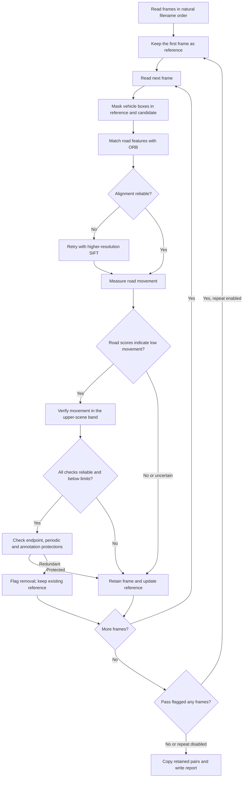

# FrameThinner

FrameThinner reduces redundant frames extracted from one video. It writes the
retained images into a separate output folder, preserving filenames, and can
copy their YOLO labels. A JSON report explains every decision and pass.

## Quick start on Ubuntu

Use Python 3.12 and an NVIDIA driver compatible with PyTorch CUDA 12.6.

```sh
python3.12 -m venv .venv
. .venv/bin/activate
python -m pip install --upgrade pip
python -m pip install torch==2.7.1 torchvision==0.22.1 --index-url https://download.pytorch.org/whl/cu126
python -m pip install -r requirements.txt
python frame_thinner.py /data/video_frames /data/video_frames_thinned
```

For Windows, create the venv with `py -3.12 -m venv .venv` and activate it
with `..venvScriptsActivate.ps1`, then use the same pip commands. For a
CPU installation, replace `cu126` with `cpu` in the PyTorch index URL.

Place a trusted COCO Ultralytics checkpoint at `models/context.pt`. The
local Windows installation includes our YOLO11n checkpoint. When setting up
another machine, obtain [yolo11n.pt from the publisher](https://github.com/ultralytics/assets/releases/tag/v8.3.0)
and rename it to `context.pt`, or set `vehicles.weights` in YAML. Model
files and environments are excluded from Git. The model's own license applies.

## Commands

```sh
# Images only, with defaults from config.yaml
python frame_thinner.py /data/frames /data/filtered

# Copy the retained images and corresponding YOLO box labels
python frame_thinner.py /data/images /data/filtered --labels /data/labels

# Compute decisions and write report.json without copying retained images
python frame_thinner.py /data/images /data/dry_run --dry-run

# Use another complete or partial YAML configuration
python frame_thinner.py /data/images /data/filtered --config settings.yaml
```

Every run requires a new output folder. Outputs contain `report.json`,
`images/` and, when requested, `labels/`. Empty labels are valid. Missing
labels or duplicate image stems are rejected before processing with labels.
The source folders are read only. A failed or interrupted run can leave a
partial output folder. Use a new output folder to rerun.

The input must contain frames from **one recording in chronological filename
order**. The tool reads supported images directly inside that folder and sorts
filenames naturally, so `frame2.jpg` precedes `frame10.jpg`. It does not infer
recording continuity or process nested sequence folders. Split separate videos
before using it. Frames should have normalized EXIF orientation.

## How it works



Each candidate is compared with the **last retained frame**. Flagged frames
do not become references. With `repeat_until_stable: true`, another pass
checks the remaining frames, stopping as soon as a pass flags zero frames.
A single greedy pass often already reaches that result.

A reliable alignment requires distinctive feature matches, enough RANSAC
inliers, a minimum inlier ratio and enough spatial coverage. Failed ORB
alignments can retry with SIFT at higher resolution. Frames with insufficient
evidence are retained.

All four movement checks must qualify before a frame can be flagged.

| Check | Score on the 640x480 working basis | Removal condition |
| --- | --- | --- |
| Typical road vertical movement | Median absolute vertical shift across nine grid points, divided by 480 | Below `maximum_motion` |
| Peak road sideways movement | Largest absolute horizontal shift across that grid, divided by 640 | Below `maximum_motion` |
| Peak road movement | Largest combined horizontal/vertical shift, divided by 480 | Below twice `maximum_motion` |
| Peak upper-scene movement | Same combined shift in the separate near-horizon band | Below twice `maximum_motion` |

Higher movement supports retaining a frame. Higher `maximum_motion` makes
removal more aggressive. These scores measure image displacement. They have
no calibrated conversion to distance traveled.

The default regions exclude the dashboard in the tested Nienaber footage.
They are configurable because camera mounting and field of view vary.
Vehicle masking excludes both moving and parked cars, motorcycles, buses,
and trucks. Sky features are included by default, matching the latest trial.

The first and last frames always remain. With labels supplied, a frame also
remains when its defect boxes differ materially from the reference. Current
box matching requires equal counts, matching class IDs, IoU of at least 0.65
and box area ratio of at least 0.75. This protection can retain some visually
similar frames. It supports YOLO bounding boxes, with five values per line.

## Settings, progress and performance

The [commented YAML](config.yaml) documents units, ranges and the effect of
each setting. Partial overrides inherit unspecified settings from the default
file. Unknown keys are rejected.

The console prints the current pass, frames checked, retained count,
comparison speed and estimated remaining time for that pass. The final JSON
contains configuration, per-frame evidence, reference filenames, pass counts
and elapsed time. Decisions are `remove_candidate`, `retain`, or
`uncertain`; uncertain frames remain in the output.

Feature matching runs on CPU. The optional vehicle detector uses CUDA when
available. Recent descriptors and masks have bounded caches, and the detector
releases references to its previous image and inference results. Feature
comparison is sequential because the next reference depends on prior decisions.

## License

Application source is AGPL-3.0. Ultralytics, OpenCV, NumPy, PyYAML, PyTorch,
and model files have their own terms. Preserve their notices when distributing
dependencies. See [Ultralytics licensing](https://www.ultralytics.com/license).

The GitHub repository name **FrameThinner** describes the tool's purpose.
Repository-name availability has not been checked.

## Local validation

The standalone tool reproduced the reviewed 0.100 result on the 75-frame
Nienaber sequence 0770, retaining the same 19 images and labels. A second
pass flagged zero additional frames. Retained output bytes matched the
source pairs. This validation ran on Windows with a GTX 1650. Ubuntu
installation and execution remain to be tested on the target computer.
